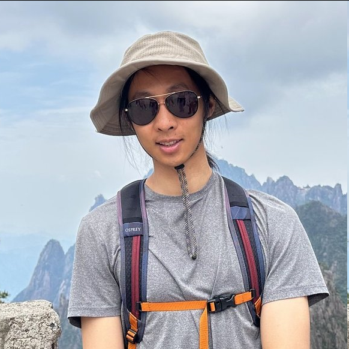

## About Me
**qyao[at]utexas[dot]edu**

I am a third year Ph.D. student in the [UT Austin Computational Linguistics group](https://sites.utexas.edu/compling/), advised by Professor [Kyle Mahowald](https://mahowak.github.io/). I am interested in how language models learn and exhibit complex linguistic and cognitive behaviors. My studies are funded by the [Harrington Fellowship](https://harrington.utexas.edu/graduate-fellows-program).

Before coming to UT, I completed a B.S. in Mathematics at the University of California, Santa Barbara in the College of Creative Studies. There, I worked with Professor [Sui Tang](https://web.math.ucsb.edu/~suitang/) on applying compressed sensing theory to graph signal processing. I also completed a senior thesis with Professor [Simon Todd](https://sjtodd.github.io/) on extracting and analyzing BERT's preferences for English dative and genitive alternations. This work received the top senior paper award in linguistics at UCSB.

## Education
**Ph.D. Linguistics**, The University of Texas at Austin, 2024 - Present 

**B.S. Mathematics**, University of California, Santa Barbara, 2020 - 2024

## Publications

See my [CV](https://dounick.github.io/cv.pdf) for the up-to-date list.